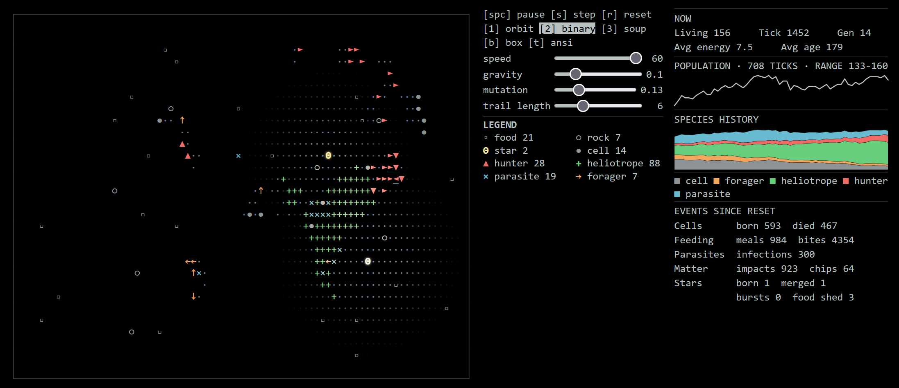
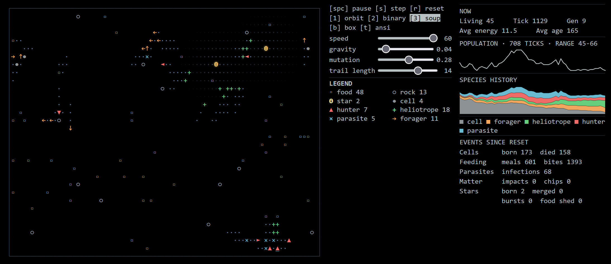
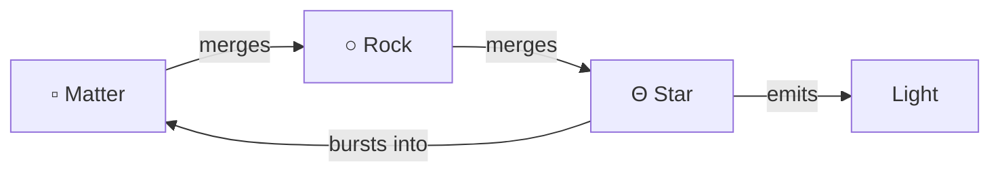

# Cosmordial





## Matter

Gravity pulls matter together:



## Life

Cells spend energy to move and reproduce. Mutations can change their role.

| Cell | Behavior |
| --- | --- |
| Forager | Seeks food; flees hunters |
| Light seeker | Seeks starlight; burns near stars; cannot be infected |
| Hunter | Sprints, tires, and drains prey; can be infected |
| Parasite | Drains and infects cells, foragers, and hunters |

## Benchmark

`npm run benchmark` runs three seeded 5,000-tick trials per preset.

## Embed

In your host app:

```sh
npm install ../cosmordial
```

```js
import 'cosmordial';
```

```html
<cosmordial-universe width="800" height="450" preset="binary" theme="amber"></cosmordial-universe>
```

The `width` and `height` attributes set the visible field size in pixels. The existing simulation grid stretches to fill that area. Use **⛶** to enter or leave fullscreen. The **−** and **+** controls appear only in fullscreen and step through 20%, 30%, 40%, 50%, 60%, 70%, 80%, 90%, 100%, 110%, 125%, 135%, 150%, 175%, and 200%. Zoom changes the simulation's boundaries and number of cells while keeping the field filled; cells outside a smaller box boundary are removed. Torus boundaries keep every entity. If entities cannot fit without overlaps, both boundary modes continue ticking and retry separation later. Use `cols` and `rows` to set the grid size at 100% zoom. On mobile, fullscreen adjusts the number of rows to keep cells close to square. Below 40% zoom, the field uses compact pixel rendering because individual characters become too small to read.

The amount of free matter allowed and its spontaneous generation rate both scale with the grid area. Doubling the area doubles both; new matter builds up over time.

All component options are HTML attributes. Set them in markup or update them from JavaScript:

```js
const universe = document.querySelector('cosmordial-universe');
universe.setAttribute('width', '900');
universe.setAttribute('height', '500');
universe.setAttribute('speed', '30');
```

| Attribute | Default | Effect |
| --- | --- | --- |
| `width` | automatic | Visible field width in pixels (`80`–`4096`). |
| `height` | automatic | Visible field height in pixels (`80`–`2160`). |
| `cols` | `80` on desktop; fits narrow screens | Number of simulation columns. Changing it resets the world. |
| `rows` | `30` on desktop; `22` on narrow devices | Number of simulation rows. Changing it resets the world. |
| `preset` | `orbit` | Starting world: `orbit`, `binary`, or `soup`. Changing it resets the world. |
| `theme` | `ansi` | Color theme: `ansi`, `green`, `amber`, or `colorblind`. |
| `speed` | `25` | Simulation ticks per second. The view slider covers `1`–`60`. |
| `gravity` | `0.1` | Gravity strength. The view slider covers `0`–`0.5`. |
| `mutation` | `0.25` | Mutation rate. The view slider covers `0`–`0.5`. |
| `trail-length` | `6` | Trail persistence in ticks. The view slider covers `0`–`20`; `0` turns trails off. |
| `boundary` | `box` | Edge behavior: `box` or `torus` (wraparound). |
| `autoplay` | on | Set to `false` to start paused. |
| `transparent` | absent | Add the attribute to make the component background transparent. |
| `autofocus` | absent | Add the attribute to focus the component when it connects. |

The view also has buttons for run/pause, step, reset, presets, boundary, and theme. When the component has focus, use **Space** to run or pause, **S** to step, **R** to reset, **1**-**3** for presets, **B** for boundary, and **T** for theme. Use the fullscreen button to enter or leave fullscreen. **+**/**−** zoom only in fullscreen. In fullscreen, Ctrl/Command + **+** or **−** changes simulation zoom instead of browser zoom; Ctrl/Command + **0** resets it to 100%. Ctrl/Command + wheel also changes simulation zoom.

To measure the 20% mobile scenario, run `npm run benchmark -- --presets=soup --seeds=1 --ticks=900 --window=100 --base-cols=24 --base-rows=22 --cols=120 --rows=260 --boundary=box` (or `torus`). For browser frame timing, run `npm run dev` and open `/scripts/browser-benchmark.html` on the printed local server URL. The page reports average frame and step plus draw times after 500 seeded ticks.

Memory use is tied to the grid and live entities, rather than elapsed ticks. Population histories keep only the latest 721 samples, and the neighbor cache keeps at most four grid configurations. Separation reuses typed buffers, shrinks oversized buffers after populations or grids contract, and releases them with their world. Switching to compact rendering releases the hidden character grid; switching back releases the canvas backing store. Population and world size are not capped, so growing either still requires more memory.

For a reproducible long-run memory check, use `npm run benchmark -- --ticks=25000 --seeds=1 --sample=5000`. Each checkpoint reports population, heap, array buffers, and process memory after forced garbage collection. Heap and array-buffer trends describe retained JavaScript state; process memory can remain higher because the runtime keeps allocated pages. `--sample=0` (the default) disables checkpoints and their extra garbage collections for timing runs.
