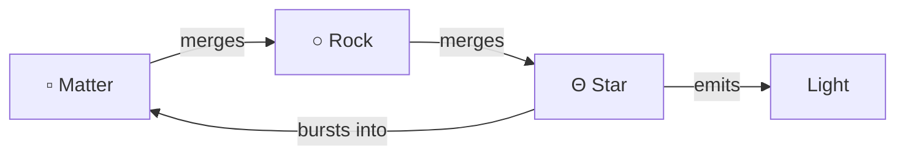

# Cosmordial

## Matter

Gravity pulls matter together:



## Life

Cells spend energy to move and reproduce. Mutations can change their role.

| Cell | Behavior |
| --- | --- |
| Forager | Seeks food; flees hunters |
| Light seeker | Seeks starlight; burns near stars; cannot be infected |
| Hunter | Chases and drains cells and foragers; can be infected |
| Parasite | Drains and infects cells, foragers, and hunters |

## Embed

In your host app:

```sh
npm install ../cosmordial
```

```js
import 'cosmordial';
```

```html
<cosmordial-universe></cosmordial-universe>
```
